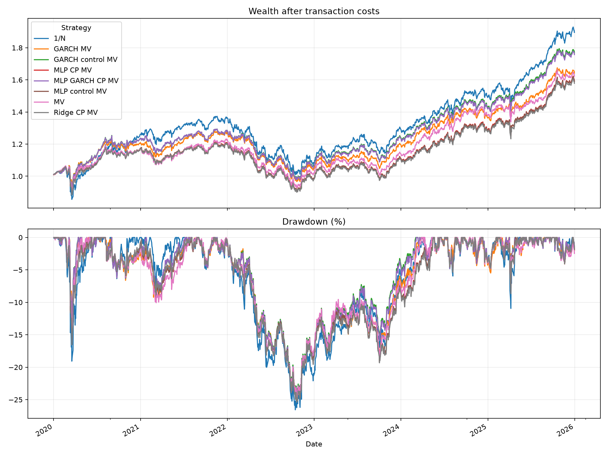

# Conformal Portfolio DSS — thử nghiệm baseline

**Đề tài:** Xây dựng hệ hỗ trợ quyết định phân bổ và tái cân bằng danh mục đầu tư có xét đến rủi ro và bất định dự báo.

**Hướng nghiên cứu:** Uncertainty-aware portfolio allocation and rebalancing via regime-adaptive conformal prediction for multivariate financial time series.

Repository này là thử nghiệm ban đầu theo yêu cầu của giảng viên: dựng pipeline dự báo → conformal chuẩn → robust minimum variance trên ETF để kiểm tra liệu bất định có giúp ích cho quyết định danh mục. Chưa triển khai regime-adaptive conformal, vùng dự báo đồng thời đa biến hoặc tái cân bằng theo mức bất định.

## Xem code và kết quả mà không chạy lại

**Thứ tự đọc đề xuất:** [Báo cáo](Report.pdf) → [Notebook chính](03_torch_garch_baseline.ipynb) → [Bảng kết quả](results_torch_garch/portfolio_metrics.csv).

- **[Notebook chính — có sẵn output](03_torch_garch_baseline.ipynb)**: GitHub có thể hiển thị code và kết quả đã lưu. Nếu phần notebook không tải, tải repository và mở bằng VS Code/Jupyter.
- **[Báo cáo — PDF](Report.pdf)**: mục tiêu, sơ đồ pipeline, phương pháp, các bảng kết quả và kết luận.
- **[Chỉ số danh mục](results_torch_garch/portfolio_metrics.csv)**, [độ phủ và độ rộng](results_torch_garch/conformal_coverage.csv), [độ phủ theo năm](results_torch_garch/coverage_by_year.csv), [MAE dự báo](results_torch_garch/forecast_mae.csv), [đánh giá biến động](results_torch_garch/volatility_metrics.csv).
- [Backtest từng ngày](results_torch_garch/daily_backtest.csv), [tỷ trọng tái cân bằng](results_torch_garch/monthly_weights.csv), [cấu hình và phiên bản thư viện](results_torch_garch/run_config.json).



## Thiết kế thử nghiệm

- 5 ETF: SPY, QQQ, TLT, GLD, EEM; giá điều chỉnh Yahoo Finance, giai đoạn 2010–2025.
- Train 2010–2018; calibration 2019; test 2020–2025. Validation nội bộ MLP dùng 2018, sau đó refit toàn bộ train.
- 25 đặc trưng: lợi suất 5 ngày trễ của 5 ETF; dự báo lợi suất 5 ETF ngày kế tiếp.
- Ridge và MLP PyTorch; GARCH(1,1) bằng `arch` fit trên train, cập nhật trạng thái sau khi quan sát lợi suất.
- Split conformal tuyệt đối và split conformal chuẩn hóa theo sigma GARCH, mục tiêu độ phủ **biên từng ETF** 90%.
- Long-only, tổng tỷ trọng bằng 1; covariance/correlation 252 ngày quá khứ; tái cân bằng đầu tháng; phí 10 bps trên mỗi giá trị mua/bán, gồm phân bổ ban đầu từ tiền mặt.
- Robust MV dùng tập covariance `S + diag(d)`, với `0 <= d_i <= lambda * halfwidth_i²`, `lambda=1`. Cách nối khoảng lợi suất với covariance là giả định baseline, **không có bảo đảm conformal cho covariance thật**.

## Kết quả chính của lần chạy được lưu

| Danh mục | CAGR (%/năm) | Volatility (%/năm) | Sharpe (rf=0) | Max drawdown (%) |
|---|---:|---:|---:|---:|
| 1/N | 11.278 | 13.793 | 0.844 | -26.564 |
| MV | 8.422 | 11.231 | 0.776 | -24.682 |
| GARCH MV | 8.642 | 10.936 | 0.813 | -24.533 |
| MLP GARCH CP MV | 9.879 | 11.350 | 0.887 | -24.473 |
| GARCH control MV | 9.994 | 11.302 | 0.899 | -24.241 |

MLP chưa cải thiện MAE nhất quán. Conformal chuẩn hóa GARCH đạt độ phủ 84.88–89.59%, gần mục tiêu hơn nhưng khoảng rộng hơn. Danh mục kết hợp có Sharpe cao hơn MV thường, song chưa vượt robust đối chứng; vì vậy **chưa xác nhận lợi ích riêng của conformal**. Đây là kết quả mô tả trên một bộ tài sản, một seed và một giai đoạn test; chưa kiểm định thống kê.

## Chạy lại

Tải repository bằng **Code → Download ZIP** và giải nén, hoặc:

```bash
git clone https://github.com/phuongtw/conformal-portfolio-dss.git
cd conformal-portfolio-dss
python -m venv .venv
```

Kích hoạt môi trường:

```powershell
# Windows PowerShell
.\.venv\Scripts\Activate.ps1
```

```bash
# macOS / Linux
source .venv/bin/activate
```

```bash
python -m pip install -r requirements.txt
python src/03_torch_garch_baseline.py
```

Để chạy notebook, mở **thư mục repository** bằng VS Code, chọn interpreter/kernel `.venv`, rồi Run All. Hoặc cài JupyterLab bằng `python -m pip install jupyterlab`, chạy `jupyter lab` và mở notebook. Notebook đã nhúng các hàm nên không cần nhập riêng helper.

Lần chạy gốc dùng Python 3.14.6; phiên bản thư viện chính được ghi trong [run_config.json](results_torch_garch/run_config.json). `requirements.txt` dùng các phiên bản đã chạy và các thư viện hỗ trợ notebook. Nên dùng Python 3.14 để tái lập gần nhất; cần kiểm tra wheel phù hợp nếu dùng phiên bản Python khác.

Cache [data/etf_adjusted_close_2010_2025.csv](data/etf_adjusted_close_2010_2025.csv) được dùng mặc định, tránh thay đổi lịch sử giá giữa các lần chạy. Chỉ đặt `REFRESH_DATA=True` nếu muốn tải lại; cần Internet khi tải mới. Output được ghi đè trong `results_torch_garch/` mỗi lần chạy, nên giữ một bản kết quả gốc nếu muốn so sánh.

## Cấu trúc dự án

```text
conformal-portfolio-dss/
├── README.md                         # Hướng dẫn và kết luận
├── Report.pdf                        # Báo cáo gửi giảng viên
├── 03_torch_garch_baseline.ipynb      # Notebook chính, đã lưu output
├── requirements.txt                  # Thư viện cần cài
├── data/                             # Dữ liệu dùng để tái lập
├── results_torch_garch/              # Kết quả hiện tại: CSV, biểu đồ, model
├── src/                              # Mã Python và các hàm hỗ trợ
├── tools/                            # Script xây notebook và kiểm tra
└── archive/                          # Bản Ridge cũ và kết quả cũ
```

| Thư mục | Khi nào cần mở? |
|---|---|
| [src/](src/) | Muốn chạy bản Python hoặc xem hàm tối ưu, MLP và GARCH. |
| [tools/](tools/) | Muốn kiểm tra tính đúng đắn hoặc xây lại notebook sau khi sửa code. |
| [archive/](archive/) | Muốn xem quá trình từ dữ liệu/Ridge đến baseline danh mục ban đầu; không cần chạy trước notebook chính. |

- [src/03_torch_garch_baseline.py](src/03_torch_garch_baseline.py) là bản chạy terminal tương đương notebook; chạy từ **thư mục gốc repository** để dùng đúng cache/output.
- `src/torch_garch_extension.py` và `src/portfolio_baseline.py` chứa phần code hỗ trợ. Notebook chính đã nhúng các hàm, không phụ thuộc đường dẫn nhập các file này.
- Kiểm tra bằng `python tools/verify_torch_garch.py`.
- `tools/build_torch_garch_notebook.py` tạo lại bản chính; `tools/build_baseline_notebook.py` tạo bản Ridge trong archive. Chạy builder sẽ xóa output notebook đã lưu; chỉ dùng khi chỉnh mã nguồn.
- Notebook trong `archive/` được giữ để tham khảo lịch sử. Nếu muốn chạy bản cũ, chạy script `.py` từ thư mục gốc repository; kết quả cũ được lưu trong `archive/results_baseline/`.

## Phạm vi nghiên cứu tiếp theo

Hiệu chỉnh rolling/online rồi theo chế độ, vùng bất định đa biến, cầu nối bất định–phân bổ và quy tắc giao dịch dựa trên lợi ích sau phí. Test 2020–2025 đã được xem; phát triển phương pháp cần đánh giá độc lập hoặc nested walk-forward.

Giá lấy từ Yahoo Finance; dữ liệu trong repo là bản dùng để tái lập thử nghiệm, không phải dữ liệu do tác giả sở hữu hay cung cấp chính thức. Kết quả là thực nghiệm học thuật.
